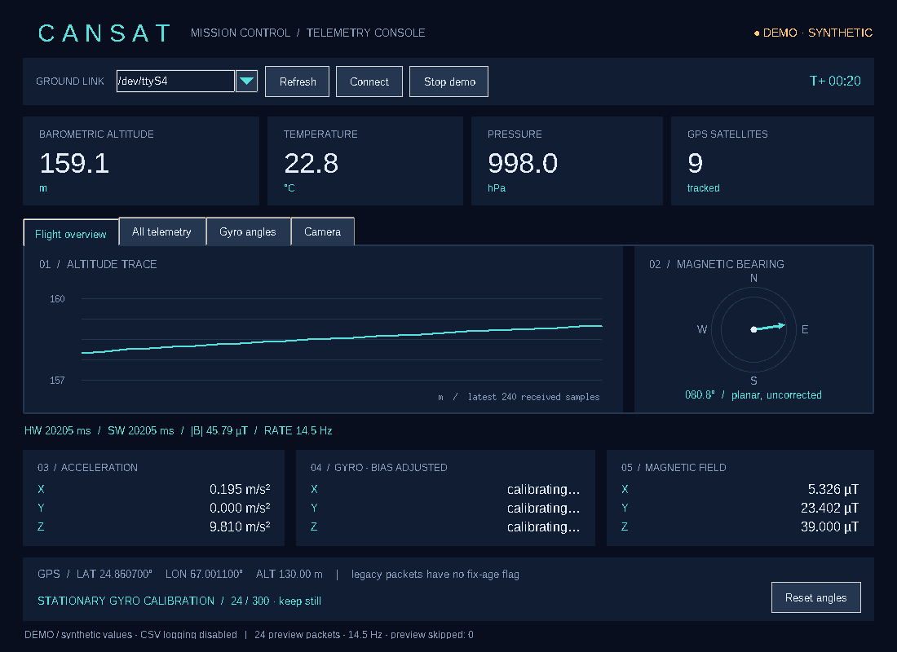
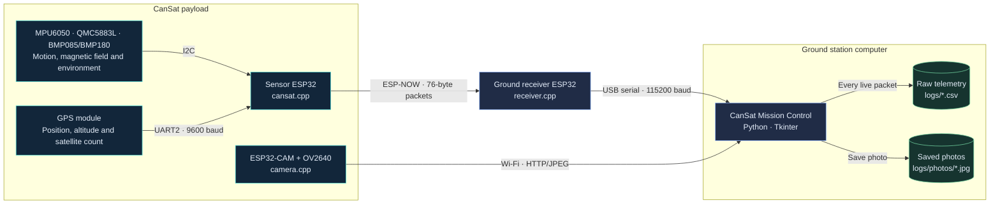

# CanSat Mission Control

CanSat Mission Control brings together Arduino C++ firmware and a Python Tkinter ground station for an ESP32-based CanSat. Onboard sensors measure temperature, pressure, altitude, acceleration, angular velocity, magnetic field and GPS position. The sensor board transmits these readings over ESP-NOW to an ESP32 ground receiver, which forwards them to the computer through USB.

The dashboard displays live telemetry, altitude history, magnetic heading and gyro calibration, while recording raw readings to timestamped CSV files for later analysis. A separate ESP32-CAM payload adds Wi-Fi camera preview and photo saving. The application also includes a clearly labelled demo mode for exploring the telemetry interface without connecting hardware.



## Quick start: demo

Use **Python 3.12** to match the tested desktop setup. From the repository root, create a virtual environment:

```bash
python -m venv .venv
```

Activate it for your operating system:

| Operating system | Activation command |
| --- | --- |
| Linux / macOS | `source .venv/bin/activate` |
| Windows PowerShell | `.\.venv\Scripts\Activate.ps1` |

Install the desktop dependencies and start the demo:

```bash
python -m pip install -r requirements.txt
python ground_station/main.py --demo
```

No board or PlatformIO installation is needed for the demo. The telemetry is labelled synthetic and is not written to CSV. Python must include Tcl/Tk support; see [Python and Tkinter](#python-and-tkinter) if it is missing. For connected hardware, follow the [hardware setup](#1-prepare-the-hardware-and-settings) and [firmware instructions](#2-build-arduino-c-firmware).

## Contents

- [Quick start: demo](#quick-start-demo)
- [Features](#what-it-does)
- [System architecture](#system-architecture)
- [Project structure](#simple-project-structure)
- [Code organization](#code-organization)
- [Sensors and telemetry](#sensors-and-telemetry)
- [Hardware and board roles](#1-prepare-the-hardware-and-settings)
- [Build and upload firmware](#2-build-arduino-c-firmware)
- [Run the ground station](#3-run-the-ground-station)
- [Camera payload](#camera-payload)
- [CSV and protocol](#csv-and-protocol)
- [Calibration and limits](#calibration-and-limits)
- [Troubleshooting](#troubleshooting)
- [Checks and verification](#checks)
- [Background and references](#project-background-and-references)

## What it does

- BMP085/BMP180 temperature, pressure and barometric altitude.
- MPU6050 acceleration and angular velocity; QMC5883L magnetic field and planar heading.
- GPS position, altitude and satellite count through UART2 and NeoGPS.
- Fixed 76-byte telemetry packets over ESP-NOW, then USB serial at 115200 baud.
- Separate ESP32-CAM camera firmware with Wi-Fi JPEG preview and photo saving.
- One space-themed window: telemetry cards, altitude trace, compass, sensor axes and GPS.
- Stationary 300-sample gyro bias calibration and body-axis angle integration.
- Raw packet CSV logging with UTC receive timestamps; separate, clearly marked demo mode.

## System architecture

Sensor telemetry and camera images use separate wireless paths and meet in the desktop application.



The ground receiver stays connected through USB while the computer joins the camera's Wi-Fi. Camera images are transferred independently of the 76-byte telemetry stream.

## Simple project structure

```text
.
├── README.md
├── platformio.ini            # Arduino framework, board profile and dependencies
├── requirements.txt          # Desktop dependencies: pyserial and Pillow
├── firmware/
│   ├── include/
│   │   ├── config.h          # Sensor MAC, pins, channel, intervals and altitude
│   │   ├── camera.h          # Camera pins and Wi-Fi settings
│   │   ├── telemetry.h       # Shared, size-checked wire format
│   │   └── radio.h           # Shared radio setup
│   └── src/
│       ├── cansat.cpp        # One BMP-enabled transmitter
│       ├── receiver.cpp      # Radio to binary USB bridge
│       ├── mac_address.cpp   # Receiver MAC discovery tool
│       └── camera.cpp        # Separate AI Thinker ESP32-CAM payload
├── ground_station/
│   ├── main.py               # Command-line entry point
│   ├── mission_control.py    # Connections, sessions and update loop
│   ├── dashboard.py          # Window layout and telemetry drawing
│   ├── camera_gui.py         # Camera tab and photo saving
│   ├── camera_reader.py      # Background HTTP/JPEG reader
│   ├── serial_reader.py      # Serial worker and raw CSV writer
│   └── telemetry.py          # Binary decoder and gyro state
├── dashboard.png             # Synthetic-demo screenshot used by this README
├── tests/                    # Parser, integration and serial-to-CSV checks
└── .github/workflows/        # Firmware and Python checks on GitHub
```

Generated `logs/`, `.pio/`, Python caches and virtual environments are ignored by Git.

## Code organization

Run `ground_station/main.py` to start the application. `mission_control.py` manages live/demo sessions, packet processing and worker shutdown. `dashboard.py` builds and refreshes the Tk widgets. Serial I/O and CSV recording live in `serial_reader.py`; packet decoding and gyro calibration live in `telemetry.py`. The camera has its own tab and HTTP worker in `camera_gui.py` and `camera_reader.py`.

Workers send data through queues; all widget updates run on Tk's main thread. The firmware remains one program per board or utility: sensor transmitter, receiver, camera and MAC discovery. Shared headers define configuration, radio settings and the fixed telemetry format.

Source comments explain timing, calibration, buffer ownership and hardware assumptions. `.editorconfig` specifies spaces and line endings; `.clang-format` keeps C++ formatting consistent. Python uses four-space indentation, and C++ uses two spaces with opening braces on their own lines.

## Sensors and telemetry

The CanSat measures motion, magnetic field, atmospheric conditions and GPS position. The sensor ESP32 samples these devices and transmits their readings to the ground station. A separate ESP32-CAM provides camera images over Wi-Fi.

| Sensor or module               | Measurements                                                                               | Units                                         | Connection                                |
| ------------------------------ | ------------------------------------------------------------------------------------------ | --------------------------------------------- | ----------------------------------------- |
| MPU6050 accelerometer          | Acceleration along the sensor's X, Y and Z axes (`ax`, `ay`, `az`)                         | m/s²                                          | I2C                                       |
| MPU6050 gyroscope              | Angular velocity around X, Y and Z (`gx`, `gy`, `gz`)                                      | rad/s                                         | I2C                                       |
| QMC5883L magnetometer          | Magnetic field along X, Y and Z (`mx`, `my`, `mz`); planar magnetic heading (`head`)       | µT; degrees                                   | I2C                                       |
| BMP085/BMP180 barometer        | Temperature (`temp`), atmospheric pressure (`press`) and pressure-derived altitude (`alt`) | °C; Pa; m                                     | I2C                                       |
| NMEA-compatible GPS module     | Latitude (`lat`), longitude (`lon`), GPS altitude (`gpsAlt`) and satellite count (`sat`)   | Decimal degrees; m; count                     | UART2 at 9600 baud                        |
| OV2640 on AI Thinker ESP32-CAM | JPEG images for live preview and photo saving                                              | 640 × 480 with PSRAM; 320 × 240 without PSRAM | Separate camera board and Wi-Fi HTTP link |

### Motion: MPU6050

The accelerometer is configured for a **±2 g** range. A stationary reading includes gravity, so the combined X/Y/Z magnitude should be approximately **9.81 m/s²**; individual axes depend on the sensor's orientation.

The gyroscope is configured for **±500°/s**, while its library outputs telemetry in **rad/s**. The MPU6050 filter bandwidth is set to **184 Hz**. These are sensor settings, not a guarantee of the end-to-end telemetry update rate.

Raw gyro rates are available in **All telemetry**. The overview displays bias-adjusted rates after calibration, and **Gyro angles** displays integrated body-axis rotation. See [calibration and limits](#calibration-and-limits) for the stationary-sample requirement, angle reset and drift limitations.

### Magnetic field and heading: QMC5883L

Firmware reads the magnetometer through Arduino `Wire`. It is configured for **±8 gauss** and converts signed sensor counts using **100/3000 µT per count**. The GUI calculates total magnetic-field magnitude as `sqrt(mx² + my² + mz²)`.

Firmware calculates planar heading from `atan2(my, mx)`. The compass displays it in the **0–360°** range, while the transmitted value is available in **All telemetry**. Heading is not tilt-compensated; nearby magnetic materials, sensor mounting and calibration affect interpretation. See [sensor timing and missing values](#sensor-timing-and-missing-values) for failure handling.

### Temperature, pressure and altitude: BMP085/BMP180

The barometer supplies temperature and pressure. Firmware estimates altitude from pressure using the launch-site reference configured as `referenceAltitudeM` in `firmware/include/config.h`. Barometric altitude and GPS altitude are separate measurements and can differ.

See [CSV and protocol](#csv-and-protocol) for stored units and [sensor timing](#sensor-timing-and-missing-values) for refresh intervals.

### Position: GPS

The GPS module connects through **UART2**, with ESP32 RX on GPIO16 and TX on GPIO17. Firmware consumes NMEA messages at **9600 baud** and forwards valid position, altitude and satellite-count fields.

Allow the GPS receiver to obtain a valid fix before expecting position data. Unavailable position and altitude appear as dashes; [sensor timing and missing values](#sensor-timing-and-missing-values) explains expiry behavior. Satellite count alone does not establish position accuracy.

### Derived readouts

| Readout | Meaning |
| --- | --- |
| Update rate | Rate estimated from recent positive hardware timestamp intervals |
| Magnetic magnitude | Combined magnitude of the three magnetic axes, in µT |
| Integrated gyro angles | Accumulated bias-adjusted body-axis rotation, in degrees |

[CSV and protocol](#csv-and-protocol) defines the hardware, software and UTC timestamps. Sensor values are logged as received; gyro bias adjustment and angle integration are display calculations.

### Viewing the data

- **Flight overview:** environmental cards, altitude trace, compass, acceleration, bias-adjusted gyro rates, magnetic axes and GPS.
- **All telemetry:** a scrollable table containing every raw field, including raw gyro rates, pressure in Pa, timestamps and magnetic magnitude.
- **Gyro angles:** X/Y/Z integrated-angle dials with calibration status and angle reset.
- **Camera:** independent camera connection, JPEG preview and photo saving.

The timing strip shows hardware/software milliseconds, magnetic magnitude and update rate. Sensor values come from the connected hardware during live operation; **Demo** mode generates clearly labelled synthetic telemetry.

## 1. Prepare the hardware and settings

For sensor telemetry, use **two compatible classic ESP32 boards**, a BMP085/BMP180, MPU6050, QMC5883L and NMEA GPS module. Add a separate **AI Thinker ESP32-CAM with OV2640** for camera preview. Keep the ground receiver attached to the computer through a USB data cable.

| Physical board | Build target | Source file | Role |
| --- | --- | --- | --- |
| CanSat sensor ESP32 | `cansat` | `firmware/src/cansat.cpp` | Sample sensors and transmit telemetry over ESP-NOW |
| Ground receiver ESP32 | `receiver` | `firmware/src/receiver.cpp` | Receive telemetry and forward it to the computer through USB |
| Optional ESP32-CAM payload | `camera` | `firmware/src/camera.cpp` | Capture JPEG images and provide the camera Wi-Fi access point |
| Ground receiver ESP32, during setup | `mac_address` | `firmware/src/mac_address.cpp` | Print its station MAC; replace this utility with `receiver` afterward |

MAC discovery reuses the ground receiver; it does not require a fourth board. The complete camera-enabled system uses three physical boards.

`platformio.ini` uses **`esp32dev` as the example profile** for the sensor and receiver, and **`esp32cam` for the AI Thinker camera target**. Confirm the selected profile and pin assignments match each physical board before uploading. Sensor telemetry needs no router; the camera creates its own password-protected Wi-Fi access point.

| Connection          | Setting in this project                                                            |
| ------------------- | ---------------------------------------------------------------------------------- |
| Sensor I2C          | Board's default `SDA` / `SCL`; commonly GPIO21 / GPIO22 for classic ESP32 profiles |
| GPS to ESP32 RX     | GPS TX → GPIO16                                                                    |
| ESP32 TX to GPS     | GPIO17 → GPS RX, if required by your GPS module                                    |
| GPS UART            | UART2, 9600 baud, 8N1                                                              |
| Buzzer              | GPIO4, short startup pulse only                                                    |
| Receiver status LED | GPIO2; availability/polarity depends on board                                      |
| Radio               | Same channel at both ends; default 1, standard 802.11b/g/n                         |
| USB serial          | 115200 baud, 8N1                                                                   |

Check your module power requirements and wiring. **CSV is stored on the computer while the live app is connected.** There is no onboard SD recorder.

Edit `firmware/include/config.h`:

- `receiverMac`: your receiver's station MAC; initially all zero, so the transmitter refuses to start until configured.
- `channel`: same value for transmitter and receiver.
- `referenceAltitudeM`: known launch-site altitude in metres; the default 10 m is an example, not a measured site value.
- GPS/buzzer/LED pins and sampling intervals as needed for your hardware.

## 2. Build Arduino C++ firmware

Create and activate the virtual environment shown in [Quick start](#quick-start-demo). Python 3.10+ is supported; Python 3.12 matches the tested desktop setup. Install [PlatformIO Core](https://docs.platformio.org/en/latest/core/installation/index.html) in that environment, then build:

```bash
python -m pip install platformio==6.1.18
pio run
```

You can also build this project with the PlatformIO extension for VS Code. Run commands from the repository root containing `platformio.ini`.

The first build downloads the ESP32 toolchain and pinned sensor packages. All firmware is **C++ with the Arduino framework**: `Arduino.h`, `setup()` and `loop()` remain. C++ is necessary for the Arduino sensor classes; renaming to plain C would not work. PlatformIO compiles the `.cpp` files directly, so no `.ino` or `.ano` files are needed.

The project pins `espressif32@6.12.0` and its Arduino-ESP32 2.0.17 framework. The receiver also contains the newer core 3.x receive-signature branch, but the pinned 2.0.17 toolchain is the supported build configuration. See [PlatformIO's ESP32 documentation](https://docs.platformio.org/en/latest/platforms/espressif32.html).

| Dependency                   | Version            | Purpose                                                                             |
| ---------------------------- | ------------------ | ----------------------------------------------------------------------------------- |
| Adafruit BMP085 Library      | 1.2.4              | BMP085/BMP180 sensor                                                                |
| Adafruit MPU6050             | 2.2.6              | Motion sensor                                                                       |
| Adafruit Unified Sensor      | 1.1.15             | Sensor event types and units                                                        |
| Adafruit BusIO               | 1.17.2             | I2C/SPI transport support                                                           |
| NeoGPS                       | 4.2.9              | GPS sentence parsing                                                                |
| ESP32 Arduino core libraries | Framework supplied | Wire, WiFi, HardwareSerial, ESP-NOW, WebServer and the `esp_camera.h` camera driver |

### Install firmware libraries

The dependency table above matches `platformio.ini`. `pio run` automatically installs the declared packages. To install them separately without compiling or flashing, run:

```bash
pio pkg install -e cansat
```

PlatformIO puts downloaded sensor libraries in `.pio/libdeps/cansat/`. ESP32 framework packages and toolchains use PlatformIO's cache outside the repository. `.pio/` is ignored by Git, so the downloaded copies stay out of your upload. A fresh clone recreates them from `platformio.ini`; the first installation needs internet access. See [PlatformIO package installation](https://docs.platformio.org/en/latest/core/userguide/pkg/cmd_install.html).

`requirements.txt` installs **Python desktop packages**; `platformio.ini` installs **Arduino firmware libraries**. They are separate dependency lists. Use the declared PlatformIO dependencies to keep sensor-driver versions consistent. ESP32 core libraries are supplied by the framework.

### Find the receiver MAC, then upload the sensor and receiver programs

List ports:

```bash
pio device list
```

Connect the receiver and upload the temporary discovery program. Replace the example serial port with your own (`COM5` on Windows, `/dev/ttyUSB0` or `/dev/ttyACM0` on Linux, `/dev/cu.*` on macOS).

```bash
pio run -e mac_address -t upload --upload-port /dev/ttyUSB0
pio device monitor --port /dev/ttyUSB0 --baud 115200
```

Copy the station MAC into `Config::receiverMac`, for example `{0xAA, 0xBB, 0xCC, 0xDD, 0xEE, 0xFF}` for the illustrative MAC `AA:BB:CC:DD:EE:FF`. Exit the monitor with Ctrl+C. Replace the discovery program with the receiver firmware:

```bash
pio run -e receiver -t upload --upload-port /dev/ttyUSB0
```

Connect the CanSat and upload its transmitter using its own port:

```bash
pio run -e cansat -t upload --upload-port /dev/ttyUSB1
```

Rebuild/upload both boards after changing the radio channel. A sensor initialization failure stops transmission and prints a diagnostic on the **CanSat** USB port. The receiver's USB stream stays binary; rapid LED blinking indicates receiver initialization failure. A lit LED alone does not prove reception.

## 3. Run the ground station

Complete the [desktop quick start](#quick-start-demo) to install pyserial and Pillow in your virtual environment. The application requires a desktop display.

### Python and Tkinter

Tkinter is an optional part of the selected Python installation, backed by Tcl/Tk libraries. It is installed through your operating system or Python distribution, not through `requirements.txt`, which lists only pyserial and Pillow. A virtual environment uses the Tk support of the Python that created it.

Check that support with:

```bash
python -m tkinter
```

Close the test window before starting Mission Control. If the module is missing:

| Operating system | Tcl/Tk setup |
| --- | --- |
| Fedora | Install `python3-tkinter` with the system package manager |
| Debian / Ubuntu | Install `python3-tk` with the system package manager |
| Windows | Include Tcl/Tk when installing Python |
| macOS | Use a Python distribution that includes Tcl/Tk |

### Start live telemetry

For real telemetry:

```bash
python ground_station/main.py
```

1. Close Arduino Serial Monitor and any other application using the receiver port.
2. Power the ground receiver and the CanSat sensor board. Place the CanSat on a stable surface and keep it motionless.
3. Start the GUI, choose the **ground receiver's** serial port, then click **Connect**. Use **Refresh** if the receiver was attached after launch.
4. Keep the CanSat still until the **300-sample gyro calibration** finishes. At the requested 20 Hz this takes about 15 seconds; actual timing depends on reception.
5. Check the live fields, packet count and update rate. Gyro values become bias-adjusted after calibration.
6. Click **Disconnect** or close the window to stop the reader and flush/close the CSV.

A live connection starts a fresh session and calibration. To recalibrate, disconnect and reconnect while the CanSat is stationary. See [calibration and limits](#calibration-and-limits) for angle reset behavior. [Demo mode](#quick-start-demo) is available independently of a serial connection.

The GUI marks live data stale after two seconds without packets and retains the last values with the link state. The [sensor guide](#sensors-and-telemetry) explains heading and integrated-angle interpretation.

The altitude plot shows the latest 240 finite received altitude samples, equally spaced by sample index. It is not a fixed-duration time axis. All paths are resolved independently of the launch directory. Choose another live log folder with:

```bash
python ground_station/main.py --log-dir /path/to/flight-logs
```

## Camera payload

The **Camera** tab receives real JPEG images from a separate **AI Thinker ESP32-CAM / OV2640** payload. Its pins and Wi-Fi settings are in `firmware/include/camera.h`.

Install the desktop dependencies through [Quick start](#quick-start-demo), then build and upload the camera firmware:

```bash
pio run -e camera
pio run -e camera -t upload --upload-port /dev/ttyUSB0
```

Power the camera, connect your computer to its `CanSat-Camera` Wi-Fi (default password `cansat-view`), open the Camera tab and click **Start camera** with `http://192.168.4.1/capture`. Change the password in `camera.h` before deployment. Keep the sensor ground receiver connected through USB. **Save photo** writes the original received JPEG into `logs/photos/`; **Stop camera** leaves sensor telemetry running.

This feature provides live JPEG refresh and PC photo saving; onboard SD/video recording is not implemented. The [system architecture](#system-architecture) shows the independent camera and sensor data paths.

### Camera board evidence and architecture

The [SRC-UCP CK-2508 kit page](https://sites.google.com/view/space4all/cansat/) identifies a downward-looking remote-sensing camera payload. [RESOLVE's published 2025 challenge, page 6](https://resolve.uet.edu.pk/wp-content/uploads/2025/09/WSW_Challenges_For_Website_15-9-25.pdf) specifies a separately mounted ESP32-CAM. The supplied camera example selects AI Thinker ESP32-CAM with OV2640. That evidence supports this build target; it does not independently verify the exact board revision in every kit.

The camera pin map was checked against [Espressif's Arduino-ESP32 2.0.17 AI Thinker definitions](https://github.com/espressif/arduino-esp32/blob/2.0.17/libraries/ESP32/examples/Camera/CameraWebServer/camera_pins.h). Camera GPIO21/22 and other pins overlap with sensor-board defaults, so keep the two board programs and their pin assignments separate.

The [system architecture](#system-architecture) shows how the camera link and sensor telemetry reach the same ground station computer.

The camera uses [Espressif's `esp32-camera` driver](https://github.com/espressif/esp32-camera) included with the installed Arduino framework. Desktop JPEG decoding uses Pillow 12.0.0 from `requirements.txt`; HTTP networking uses Python's standard library.

### Camera upload and preview details

Use the camera board's supported USB programming adapter. Classic AI Thinker modules commonly need GPIO0 held low during reset for uploading; release it and reset for normal operation. Follow your actual board and adapter's power/programming instructions. Read startup diagnostics with:

```bash
pio device monitor --port /dev/ttyUSB0 --baud 115200
```

The firmware prints its Wi-Fi access point and capture URL. Capture uses JPEG at **640 × 480 with PSRAM**, or **320 × 240 without PSRAM**. A camera initialization failure prints an error and prevents the server starting; no substitute image is generated.

| Camera setting  | Default                                              |
| --------------- | ---------------------------------------------------- |
| Wi-Fi SSID      | `CanSat-Camera`                                      |
| Wi-Fi password  | `cansat-view`; change in `firmware/include/camera.h` |
| Wi-Fi channel   | 1                                                    |
| JPEG endpoint   | `http://192.168.4.1/capture`                         |
| Health endpoint | `http://192.168.4.1/health`                          |

The computer may report that this Wi-Fi has no internet; local camera access still works. The HTTP service has no authentication beyond joining the Wi-Fi network. No router or external trigger is required for preview.

The GUI targets up to four JPEG fetches per second, retains only the latest frame, and rejects non-JPEG responses, responses over 512 KiB and images over two megapixels. On errors it shows the failure and automatically retries while active. The last image remains visible and a three-second gap is marked stale. Resize the window for a larger preview. **Save photo** preserves the original received JPEG bytes, not a screenshot; the output follows `--log-dir` if supplied.

Camera and serial connections start and stop independently. Closing the window stops both workers. Telemetry Demo mode does not generate camera images; a separately connected camera can still provide real frames while sensor telemetry is in Demo mode. Simultaneous radio operation, range, power and image capture need physical validation.

## CSV and protocol

Each live connection creates `logs/cansat_<UTC date and time>.csv`. Each decoded packet is logged **before** UI handling, with a UTC receive timestamp, `Source=LIVE`, the 17 raw fields, and the hardware timestamp. Display calibration never alters the raw CSV. The worker flushes once per second and on normal shutdown; unexpected process/power loss can lose buffered rows. Logging errors stop the connection and appear in the status bar.

| Data                           | Unit                                                           |
| ------------------------------ | -------------------------------------------------------------- |
| `temp`, `alt`, `press`, `head` | °C, m, Pa, degrees                                             |
| `ax`, `ay`, `az`               | m/s²                                                           |
| `gx`, `gy`, `gz`               | rad/s, raw in CSV                                              |
| `mx`, `my`, `mz`               | µT with the configured QMC5883L scale                          |
| `sat`, `lat`, `lon`, `gpsAlt`  | satellite count, decimal degrees, decimal degrees, m           |
| `HardwareTimestamp`            | uint32 milliseconds since CanSat boot                          |
| `ReceivedUTC`                  | Computer UTC receive time in ISO 8601                          |
| `Source` | `LIVE` for packets decoded from a serial connection |
| `PythonTimestamp`              | Monotonic milliseconds since the live serial connection opened |

The overview displays pressure in **hPa**; the raw table and CSV retain **Pa**. Timestamp columns use different clock references and do not establish radio latency or synchronized time. The [packet layout](#packet-layout) defines the binary fields; [sensor timing](#sensor-timing-and-missing-values) describes unavailable readings.

### Example CSV

This illustrative row shows the actual column order; it is not a flight recording. `Source=LIVE` is the value the application writes for a serial connection. Demo mode does not export CSV.

```csv
ReceivedUTC,Source,PythonTimestamp,temp,alt,press,head,ax,ay,az,gx,gy,gz,mx,my,mz,sat,lat,lon,gpsAlt,HardwareTimestamp
2026-10-22T12:00:05.000+00:00,LIVE,5000,22.5,125.4,99800.0,45.0,0.02,-0.01,9.81,0.001,-0.002,0.003,20.0,20.0,35.0,9.0,24.8607,67.0011,130.0,12000
```

Here `press=99800.0` is **99,800 Pa**, displayed as **998.0 hPa**. `PythonTimestamp=5000` is five seconds since the serial session opened, while `HardwareTimestamp=12000` is twelve seconds since the sensor board booted. Gyro columns are raw rad/s values; GUI bias correction does not alter them.

### Packet layout

The wire layout follows the BMP-enabled CanSat transmitter and calibrated Python reader. ESP32 sends a little-endian 76-byte record. C++ uses fixed-width integers, float32, compile-time size and timestamp-offset assertions. Python decodes the payload with `struct.Struct('<17fI')` after the four-byte marker.

| Offset     | Field             | Type / unit                                      |
| ---------- | ----------------- | ------------------------------------------------ |
| 0          | Header            | uint32, `0xAABBCCDD`; bytes `DD CC BB AA`        |
| 4          | temp              | float32, °C                                      |
| 8          | alt               | float32, barometric m                            |
| 12         | press             | float32, Pa                                      |
| 16         | head              | float32, planar magnetic degrees, about −180…180 |
| 20, 24, 28 | ax, ay, az        | float32, m/s²                                    |
| 32, 36, 40 | gx, gy, gz        | float32, rad/s                                   |
| 44, 48, 52 | mx, my, mz        | float32, µT with configured QMC scale            |
| 56         | sat               | float32, count                                   |
| 60, 64     | lat, lon          | float32, decimal degrees                         |
| 68         | gpsAlt            | float32, m                                       |
| 72         | HardwareTimestamp | uint32, milliseconds                             |

The receiver validates length and marker, then enqueues a packet without blocking the Wi-Fi task. Its main loop writes packets to USB serial. A full 32-packet receiver queue drops the newest incoming frame. It accepts compatible frames from any sender; there is no sender authentication or encryption.

Python handles fragmented/concatenated reads and skips bytes preceding the marker. It retains up to three suffix bytes when searching, preserving split markers while bounding noise accumulation. There is no checksum, so a marker inside noise or a corrupted stream can still yield a false frame. `NaN` sensor fields are permitted and render as dashes.

### Sensor timing and missing values

- Failed QMC reads set all magnetic axes and heading to `NaN` for that packet. The [magnetometer section](#magnetic-field-and-heading-qmc5883l) defines the range and conversion.
- GPS location, altitude and satellite count expire independently after three seconds without valid updates. Location/altitude expire to `NaN`; satellite count expires to zero.
- Environment values are initialized at startup. Temperature and pressure refresh approximately every two seconds; altitude updates each sensor sample. Fields therefore have different ages.
- Hardware timestamp is sampled after sensor reads, immediately before the send request.
- The legacy float32 GPS coordinate fields have limited spatial precision. The packet contains no battery voltage, validity flags, sequence number, CRC, sender identity or application acknowledgement.

## Calibration and limits

The first **300 received gyro samples** must be stationary: their means become the X/Y/Z rate biases. The GUI then subtracts those biases and integrates angular rates into body-axis angles. **Reset angles** zeros the angle totals without changing bias; reconnect while stationary to learn a fresh bias. Calibration does not detect movement automatically.

Integration supports uint32 timestamp rollover and skips gaps longer than one second, including most reboot discontinuities. A reboot whose apparent forward gap is under one second cannot be distinguished by this packet format. Integrated body-axis angles drift and are not Euler attitude.

Acceleration and magnetic values are displayed and recorded without user-specific offsets. For a stationary gravity check, inspect the acceleration magnitude (approximately 9.81 m/s²), rather than expecting every axis to read zero. Full hard/soft-iron magnetic calibration, sensor alignment, tilt-compensated compass, and flight validation are outside this implementation. This live-monitor package does not implement Madgwick sensor fusion.

The requested transmit interval is 50 ms (up to 20 Hz); blocking BMP conversions and other work can lower the actual rate. At 115200 baud, 76-byte packets have an ideal serial ceiling of about 151 packets/s. Receiver buffering and the UI queue are bounded; queue overflow can drop frames. UI preview drops do not discard rows already logged by the worker, but calibration/integration may miss preview samples. The protocol has no sequence number or checksum, so the GUI cannot measure exact RF packet loss or detect every corrupt frame. Send-request success is not proof of end-to-end delivery.

## Troubleshooting

| Symptom                               | Check                                                                                             |
| ------------------------------------- | ------------------------------------------------------------------------------------------------- |
| No serial ports                       | USB data cable, OS driver, board power, then Refresh                                              |
| Port busy                             | Close serial monitors and other ground-station instances                                          |
| Permission denied on Linux            | Check your distribution's serial-device group/permissions and sign in again after changing groups |
| CanSat says configure MAC             | Replace the all-zero MAC in `config.h`, rebuild and upload                                        |
| No telemetry                          | Correct receiver port and MAC, both boards on same channel, successful sensor setup               |
| BMP/MPU/QMC initialization error      | Correct sensor identity, supply and I2C wiring; this version requires real BMP data               |
| Binary characters in receiver monitor | Expected: use the Python app, then close the monitor                                              |
| GPS shows dashes                      | Wait for a valid outdoor fix; check UART pins and 9600 baud                                       |
| Gyro drifts                           | Reconnect and keep stationary for calibration; integration still accumulates error                |
| No log file in demo                   | Expected; connect live serial to enable recording                                                 |
| Missing `tkinter`                     | Install OS/Python Tcl/Tk support as described above                                               |
| Camera offline                        | Power the separate camera board, join its Wi-Fi and use its `/capture` URL                        |
| Camera initialization failure         | Confirm AI Thinker/OV2640 board and pin map, ribbon connection and suitable power supply          |
| No onboard photos or video files      | This implementation saves photos on the PC; onboard recording is not implemented                  |

## Checks

```bash
python -m unittest discover -s tests -v
pio run
# Optional desktop/display check:
python tests/gui_smoke.py
```

GitHub Actions runs the unit tests and firmware build on pushes and pull requests. It checks the project on a clean GitHub runner; it does not flash boards or run the desktop GUI. The current workflow does not publish downloadable firmware artifacts.

### Verification

Local checks completed on **2026-10-22** using PlatformIO Core 6.1.18, Espressif32 6.12.0 and Arduino-ESP32 2.0.17. The sensor/receiver/discovery builds used the example `esp32dev` profile; the camera used `esp32cam`.

| Target        | Compile/link result | Static RAM             | Flash                     |
| ------------- | ------------------- | ---------------------- | ------------------------- |
| `cansat`      | PASS                | 44,292 / 327,680 bytes | 770,521 / 1,310,720 bytes |
| `receiver`    | PASS                | 43,492 / 327,680 bytes | 727,761 / 1,310,720 bytes |
| `mac_address` | PASS                | 43,408 / 327,680 bytes | 722,745 / 1,310,720 bytes |
| `camera`      | PASS                | 49,692 / 327,680 bytes | 856,961 / 3,145,728 bytes |

All **11 automated tests passed** with Python 3.12, pyserial 3.5 and Pillow 12.0.0. They cover packet fragmentation/concatenation, noise recovery, bounded buffering, `NaN` GPS, gyro bias/integration and timestamp rollover, serial-to-CSV handling through a POSIX pseudo-terminal, missing ports, JPEG validation/size limits, HTTP failures/recovery and camera worker shutdown. The seven telemetry/serial tests also passed under Python 3.14.

The desktop smoke test passed with Python 3.12 and Tk 9.0. It checks telemetry rendering and tabs, all raw fields, timestamps and magnetic magnitude, angle dials/reset, session reset, connection/disconnection and CSV flush, camera preview from a local HTTP fixture, saving identical JPEG bytes, independent camera stopping and orderly window shutdown. The actual GUI was visually inspected at 1100 × 800; the screenshot above contains synthetic telemetry.

The all-zero receiver MAC is an intentional placeholder: set the actual MAC before uploading the transmitter. Package-manager dependencies may include additional transitive versions; the verified firmware build selected the explicitly pinned BusIO 1.17.2. Generated build outputs, downloaded project libraries and Python caches remain ignored by Git.

## Project background and references

The package provides live sensor telemetry, desktop CSV logging and a separate ESP32-CAM payload. Board identity, sensor alignment and actual wiring must be confirmed against the physical kit.

### CanSat, RESOLVE and SRC-UCP links

| Resource                                            | Link                                                                                                                                |
| --------------------------------------------------- | ----------------------------------------------------------------------------------------------------------------------------------- |
| CanSat Explorer Kit (CK-2508)                       | [Space4ALL CanSat page](https://sites.google.com/view/space4all/cansat/) — kit overview, sensors, ground station and camera payload |
| RESOLVE                                             | [RESOLVE Space Camp](https://resolve.uet.edu.pk/space-camp-2025/) — CanSat activities and participating institutions                |
| Space Research Center, University of Central Punjab | [SRC-UCP](https://src.ucp.edu.pk/) — research center and CanSat projects                                                            |

Technical references include [Arduino's build process](https://docs.arduino.cc/arduino-cli/sketch-build-process), the [Espressif32 6.12.0 package manifest](https://github.com/platformio/platform-espressif32/blob/v6.12.0/platform.json), [Espressif ESP-NOW documentation](https://docs.espressif.com/projects/esp-idf/en/stable/esp32/api-reference/network/esp_now.html), and [QST's QMC5883L datasheet, Table 2](https://www.qstcorp.com/upload/pdf/202512/13-52-04%20QMC5883L%20Datasheet%20Rev.%20B.pdf). Sensor identity, alignment and the actual board/pinout still require physical confirmation.
